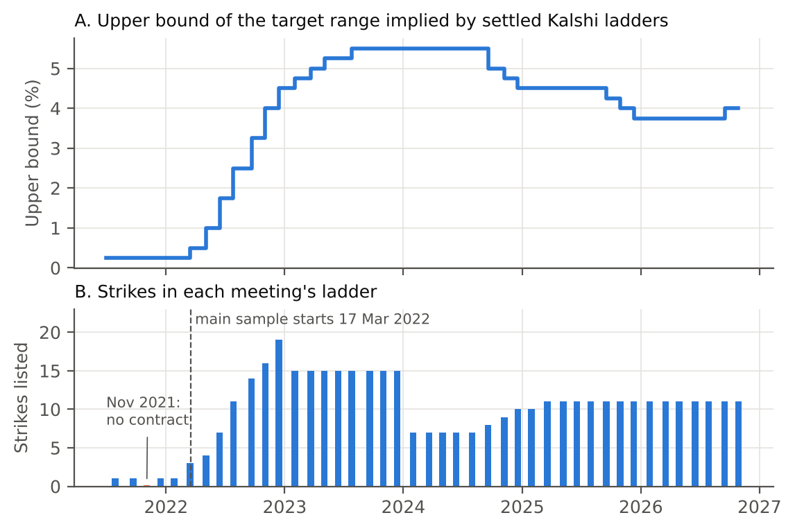
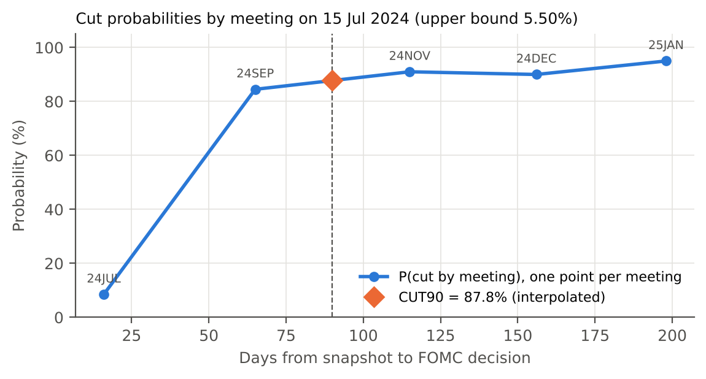
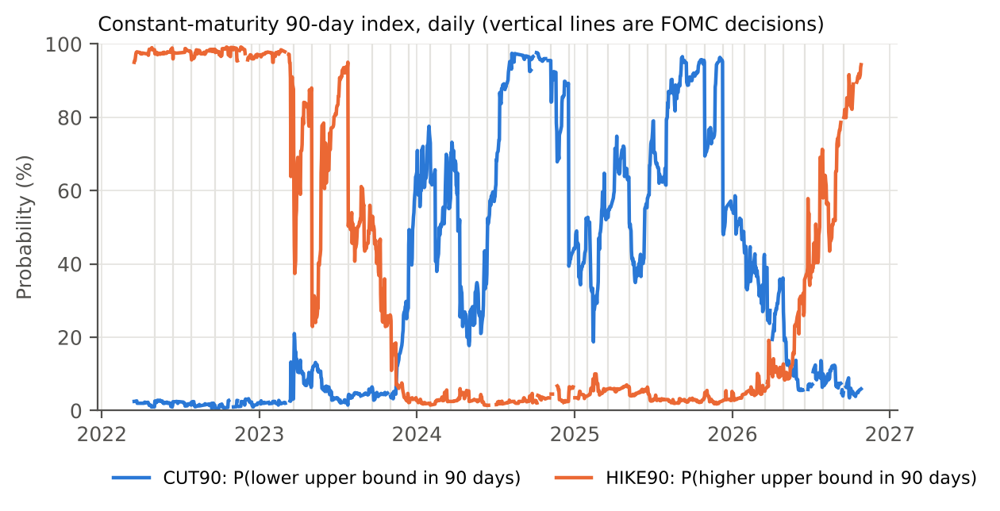
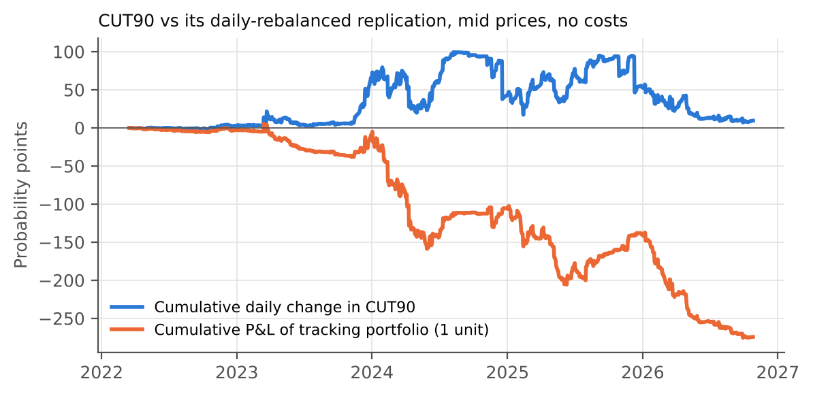

**Constant Maturity Event Futures**

Milestone 1 Report: Data, Index Construction, and Contract Design

ECE473 \| Palmer Mann, Jay Crowther, Ariel Perczek \| October 27, 2026

# 1. Summary

Kalshi lists a separate Fed decision ladder for every FOMC meeting, and
each ladder expires at its meeting. This milestone builds the inputs for
a continuous product on top of those ladders. We (i) assemble a daily
panel of every Kalshi Fed funds contract since July 2021, aligned to the
FOMC calendar; (ii) construct a 90-day constant-maturity probability
index by interpolating between the two meetings that bracket the 90-day
horizon; (iii) backtest a daily-rebalanced portfolio of event contracts
that tracks the index at mid prices; and (iv) draft a fully
collateralized futures contract on the index, with an argument that the
index is continuous between announcements.

- The panel covers 41 settled meetings and 660 contracts (100,885
  contract-days). The main sample begins 17 March 2022, the first day
  off the zero lower bound.

- The index (CUT90) is available on 95.8% of days in the main sample. It
  ranges from 0.5% to 97.6% and follows the policy cycle.

- On non-announcement days the tracking portfolio has 0.99 correlation
  with index changes and 0.32 probability points (pp) of daily tracking
  error. The residual is a deterministic roll term equal to the slope of
  the term structure between the bracketing meetings, about 26 basis
  points of probability per day on average.

- Most tracking error occurs on announcement days (2.04 pp daily
  including them), when the index's reference rate resets.

# 2. Data

## 2.1 Contracts

For each FOMC meeting Kalshi lists a ladder of binary contracts of the
form *"Will the upper bound of the federal funds target range be above
K% after the meeting?"* A contract pays \$1 if true and \$0 otherwise,
so its dollar price reads as a probability. Strikes are spaced 25 basis
points apart. The series ticker changed from FED to KXFED in January
2026; we treat both as one series. Contract wording also evolved: 2021
contracts referenced the target rate on a fixed expiration date, and
contracts from mid-2022 onward reference the upper bound after the
meeting. With 25 bp strike spacing the two definitions coincide.

## 2.2 Sources

Contract metadata and daily candlesticks come from Kalshi's public REST
API: the historical endpoints for markets settled before 28 August 2026
and the live endpoints afterward. Each daily candle reports the best bid
and ask at the close, the last trade, the volume-weighted trade price,
volume, and open interest. Candles close at midnight Eastern Time, so
our daily snapshot is 00:00 ET at the end of each calendar day. Trading
halts five minutes before the 2:00 pm ET policy statement.

Polymarket is deferred to Milestone 2. We retrieved metadata for its 24
Fed decision events (May 2024 onward). Polymarket lists outcome buckets
(for example "25 bps decrease" or "no change") rather than a strike
ladder, and its public price history gives one price per day with no bid
or ask, so it serves only as a cross-check.

## 2.3 FOMC calendar

The calendar contains the 53 scheduled meetings from July 2021 through
January 2028, with the decision timestamp set to 2:00 pm ET on the final
day. It matches the decision dates Kalshi publishes for all 41 events
that carry one. There were no unscheduled meetings in the sample. Kalshi
listed no contract for the 3 November 2021 meeting; the target range was
unchanged at that meeting.

## 2.4 Cleaning rules

- A quote with a bid-ask spread above \$0.10 is treated as missing.

- Candles are absent on some contract-days. Quotes differ before and
  after 65% of these gaps, so a missing candle is missing data rather
  than an unchanged order book. We carry the last valid mid forward for
  at most 10 days and flag carried values.

- Candles that close after the 2:00 pm ET announcement and the current,
  incomplete day are excluded.

**Table 1.** Kalshi panel by period (pre-announcement contract-days).

| **Period**           | **Contract-days** | **Contracts** | **Two-sided share** | **Median spread (\$)** | **Volume (contracts)** |
|----------------------|-------------------|---------------|---------------------|------------------------|------------------------|
| Jul 2021 to Mar 2022 | 1,838             | 43            | 0.97                | 0.02                   | 0.78M                  |
| Mar 2022 to Jan 2023 | 13,912            | 191           | 0.67                | 0.03                   | 5.90M                  |
| Feb 2023 to Dec 2024 | 24,060            | 252           | 0.81                | 0.06                   | 17.5M                  |
| Jan 2025 to Oct 2026 | 60,665            | 399           | 0.67                | 0.06                   | 33.0M                  |

Two-sided: bid above \$0 and ask below \$1. Contracts are counted in
each period in which they trade, so counts sum to more than 660.

## 2.5 Sample choice

The proposal specifies data since July 2021. We keep the full panel but
start the main analysis on 17 March 2022, for two reasons. First, until
the 16 March 2022 hike the upper bound was 0.25%, so a cut was
impossible and the cut index is identically zero by construction.
Second, through January 2022 each meeting had a single strike and the
listed meetings rarely spanned 90 days: two meetings bracket the 90-day
horizon on only 5% of days in 2021, versus at least 97% in every year
from 2022 onward. As a robustness check we repeat all results from 2
February 2023, after which every ladder has at least seven strikes
(Figure 1, panel B).

**Figure 1.** Panel A: upper bound of the target range implied by
settled ladders (the lowest strike that settled NO). The path includes
the 2022 to 2023 hiking cycle, cuts from September 2024 to December
2025, and a 25 bp increase on 16 September 2026. Panel B: number of
strikes listed per meeting.

# 3. Constant-Maturity Index

## 3.1 Definition

Let *Ut* be the upper bound in effect at snapshot *t*, and
let *Ym*(*K*, *t*) be the mid price of the YES side of
meeting *m*'s contract with strike *K*. The probability that the upper
bound after meeting *m* is below today's level, a net cut by meeting
*m*, is one minus the price of the contract struck 25 bp below
*Ut*:

*Cm*(*t*) = 1 − *Ym*(*Ut* − 0.25, *t*)
(1)

Set the target date *T* = *t* + 90 days. Let *m1* be the last
meeting with decision date *d1* ≤ *T* and *m2* the
first with *d2* \> *T*. The index interpolates linearly in
calendar time:

*wt* = (*d2* − *T*) / (*d2* −
*d1*), CUT90*t* = *wt
Cm1*(*t*) + (1 − *wt*) *Cm2*(*t*) (2)

This mirrors the VIX, which interpolates two option expiries to a fixed
30-day horizon. Because the inputs are cumulative, CUT90 measures a
*net* cut by the horizon; a cut followed by a hike does not count. The
bracketing contracts are always 35 to 146 days from their decision, so
the index never references a contract about to expire. CUT90 is the
headline index from the proposal. Because the sample contains two hiking
cycles, we also report HIKE90, defined identically with
*Hm*(*t*) = *Ym*(*Ut*, *t*), the
probability of a net hike.

## 3.2 Example

On 15 July 2024 the upper bound was 5.50% and *T* fell halfway between
the September and November meetings (*w* = 0.50). The market priced an
84.5% chance of a cut by September and 91.0% by November, so CUT90 =
87.8% (Figure 2). The Fed cut by 50 bp on 18 September 2024.

**Figure 2.** Term structure of cut probabilities on 15 July 2024 and
the interpolated 90-day point.

## 3.3 The series

CUT90 stayed near 2% through 2022, rose during 2023 as markets priced an
end to hikes, and averaged 67% in 2024 and 66% in 2025, the years in
which the Fed cut. It fell in 2026 as expectations turned toward
tightening. On 26 October 2026, the last complete day, CUT90 was 5.9%
and HIKE90 was 94.4%.

**Figure 3.** CUT90 and HIKE90, daily, 17 March 2022 to 26 October 2026.
Gaps are days on which a leg has no valid quote.

**Table 2.** Index levels by year (probability, main sample).

| **Year** | **Days** | **CUT90 mean** | **CUT90 s.d.** | **CUT90 range** | **HIKE90 mean** | **HIKE90 s.d.** | **HIKE90 range** |
|----------|----------|----------------|----------------|-----------------|-----------------|-----------------|------------------|
| 2022     | 276      | 0.018          | 0.006          | 0.005 to 0.032  | 0.977           | 0.008           | 0.950 to 0.992   |
| 2023     | 343      | 0.090          | 0.117          | 0.015 to 0.647  | 0.565           | 0.320           | 0.022 to 0.984   |
| 2024     | 353      | 0.669          | 0.250          | 0.177 to 0.976  | 0.030           | 0.012           | 0.014 to 0.067   |
| 2025     | 365      | 0.656          | 0.201          | 0.188 to 0.965  | 0.040           | 0.016           | 0.018 to 0.100   |
| 2026     | 278      | 0.207          | 0.159          | 0.035 to 0.586  | 0.321           | 0.291           | 0.028 to 0.944   |

Days counts CUT90 observations; HIKE90 counts differ slightly. 2022
starts 17 March; 2026 ends 26 October.

# 4. Tracking Backtest

## 4.1 Portfolio

At each snapshot the portfolio holds *wt* units of the
meeting-*m1* cut position and 1 − *wt* units of
the meeting-*m2* position, where a cut position is the NO
side of the contract struck at *Ut* − 0.25 (price
*Cm*). Its value therefore equals CUT90*t*. The
position is held to the next snapshot and then rebalanced to the new
weights, strike, and bracket. Trades execute at mid with no fees or
spread. Each unit is fully collateralized, as on Kalshi, so no leverage
enters. Daily P&L is

*πt+1* = *wt* Δ*Cm1* + (1 −
*wt*) Δ*Cm2* (3)

## 4.2 A built-in roll term

On a day with no announcement and no change of bracket, the weight falls
by 1/(*d2* − *d1*) as the target date advances.
Differencing equation (2) gives

ΔCUT90*t+1* − *πt+1* = \[*Cm2*(*t*+1) −
*Cm1*(*t*+1)\] / (*d2* − *d1*) ≈
*st* (4)

where *st* is the slope of the term structure per day. Even
if every contract price were a martingale (expected change zero), the
index itself would drift by *st* per day, and no portfolio of
the underlying contracts could earn that drift. VIX futures show the
same gap relative to spot VIX. This term is mechanical, and it is one of
the components the proposal aims to separate from genuine returns.

## 4.3 Results

**Table 3.** Tracking statistics, main sample (17 March 2022 to 26
October 2026).

| **Index**                | **Days** | **Corr(π, ΔI)** | **Daily TE (pp)** | **Mean ΔI − π (bp/day)** | **Mean slope s (bp/day)** |
|--------------------------|----------|-----------------|-------------------|--------------------------|---------------------------|
| CUT90, all days          | 1,599    | 0.743           | 2.04              | 17.7                     | 26.2                      |
| CUT90, ex announcements  | 1,567    | 0.991           | 0.32              | 26.2                     | 26.2                      |
| HIKE90, all days         | 1,583    | 0.722           | 2.13              | −4.7                     | 4.2                       |
| HIKE90, ex announcements | 1,550    | 0.998           | 0.12              | 4.3                      | 4.2                       |

TE: standard deviation of ΔI − π. Days require valid quotes on both legs
at t and t+1. 32 (CUT90) and 33 (HIKE90) announcement days fall in the
sample.

Away from announcements the portfolio tracks the index closely, and the
mean tracking difference equals the average slope, as equation (4)
predicts. Announcement days dominate tracking error. On those days the
upper bound can change, which moves the reference strike and re-anchors
the index even when beliefs about future meetings are unchanged.

Over the main sample one unit of the tracking portfolio lost 274
probability points (\$2.74 per \$1 of notional, before costs) while the
daily changes in CUT90 over the same days summed to +9 points (Figure
4). The losses concentrate in 2024 and 2026, when priced cuts failed to
occur on the expected schedule. We do not attribute this to the
settlement discount, a risk premium, or forecast error here; that
decomposition is a Milestone 2 deliverable.

**Figure 4.** Cumulative daily change in CUT90 and cumulative P&L of one
unit of the tracking portfolio, all backtest days, mid prices, no costs.

## 4.4 Robustness

**Table 4.** CUT90 tracking under alternative cleaning rules and samples
(non-announcement days).

| **Specification**                         | **Index coverage** | **Days** | **Daily TE (pp)** | **Mean ΔI − π (bp/day)** | **Mean slope (bp/day)** |
|-------------------------------------------|--------------------|----------|-------------------|--------------------------|-------------------------|
| Baseline: fill ≤ 10 days, spread ≤ \$0.10 | 0.958              | 1,567    | 0.32              | 26.2                     | 26.2                    |
| Fill ≤ 5 days                             | 0.890              | 1,438    | 0.32              | 27.3                     | 27.3                    |
| Fill ≤ 30 days                            | 0.997              | 1,644    | 0.31              | 25.5                     | 25.5                    |
| Spread ≤ \$0.05                           | 0.789              | 1,277    | 0.33              | 26.8                     | 26.6                    |
| Spread ≤ \$0.20                           | 0.976              | 1,602    | 0.31              | 25.9                     | 25.9                    |
| Sample from 2 Feb 2023                    | n/a                | 1,270    | 0.32              | 32.0                     | 32.0                    |

Tracking error and the roll identity are stable across specifications.
Cumulative P&L is more sensitive to the fill and spread rules and is not
reported as a result.

# 5. Futures Specification (Draft)

The contract below is a first design, to be refined in Milestone 2.
Because CUT90 is bounded between 0 and 1, the future can be fully
collateralized in the same way as the binaries beneath it: neither side
can lose more than it posts, so there are no margin calls and no
liquidations.

**Table 5.** Draft terms of the CUT90 future.

| **Term**         | **Specification**                                                                                                            |
|------------------|------------------------------------------------------------------------------------------------------------------------------|
| Underlying       | CUT90 index, quoted in points from 0 to 100                                                                                  |
| Contract unit    | Pays \$1 per index point at expiry (\$100 at CUT90 = 1)                                                                      |
| Collateral       | At a trade price F, the long locks F and the short locks 100 − F; both are held in a stablecoin escrow until settlement      |
| Payoff at expiry | Long receives the settlement value S; short receives 100 − S                                                                 |
| Expiry           | Monthly, last Friday of the month; moved to the prior Friday if within one business day of an FOMC decision                  |
| Settlement value | Mean of the daily CUT90 snapshots over the five calendar days ending on expiry, to limit manipulation of a single quote      |
| Index inputs     | Kalshi mid quotes under the Section 2.4 rules; the upper bound from the Federal Reserve's published target range             |
| Oracle           | An index publisher posts each daily value on-chain, followed by a dispute window before escrow is released                   |
| Fallback         | Days without a valid index value drop out of the average; if all five are missing, settlement waits for the next valid value |

Two design issues remain open. First, collateral in this contract is
itself locked until settlement, so by the argument of Gebele and Matthes
(2026) the future carries its own settlement discount unless escrowed
collateral earns interest. Second, the five-day averaging window trades
manipulation resistance against tracking error near expiry. Both are
quantified in Milestone 2.

# 6. Continuity Between Announcements

**Proposition 1.** Let *ak* \< *ak+1* be
consecutive FOMC announcement times. Suppose (i) *Ut* is
constant on \[*ak*, *ak+1*), (ii) each price
*Ym*(*K*, *t*) is continuous in *t*, and (iii) consecutive
meetings are less than 90 days apart. Then CUT90*t* is
continuous on (*ak*, *ak+1*).

**Proof sketch.** By (iii), a bracketing pair exists at every *t* and
*d1* \> *t*, so no bracketing contract resolves inside the
interval. Between roll times the pair is fixed, *wt* is
linear in *t*, and by (i) and (ii) each *Cm* is continuous;
CUT90 is a sum of products of continuous functions. A roll occurs at the
time τ when τ + 90 days = *d2*. As *t* approaches τ from
below, *wt* → 0 and CUT90 → *Cm2*(τ). At τ the
pair becomes (*m2*, *m3*) with weight
(*d3* − *d2*)/(*d3* − *d2*)
= 1 on *m2*, so CUT90*τ* = *Cm2*(τ).
The one-sided limits agree. The same argument applies to HIKE90. ∎

Condition (iii) holds throughout the calendar: meetings are 41 to 56
days apart. At an announcement, condition (i) fails because a change in
the upper bound moves the reference strike, so the index can jump there
even with no change in beliefs about later meetings. The construction
therefore confines mechanical discontinuities to scheduled dates; news
can still move prices on any day.

Daily data cannot prove continuity, but they are consistent with it. The
mean absolute daily change in CUT90 is 1.01 pp on ordinary days, 1.42 pp
on the 33 roll days, and 7.55 pp on the 32 announcement days. Roll days
look like ordinary days; announcement days do not. The largest move on a
non-announcement day (26.5 pp) reflects news, not the construction.

# 7. Limitations and Next Steps

Three limitations apply. First, 35% of index days use at least one
carried-forward quote. Second, the midnight snapshot cannot separate
intraday reactions. Third, the results use Kalshi alone. Milestone 2
will address the following:

- Roll cost from spreads and the Kalshi fee schedule, and capital
  requirements of the tracking portfolio.

- An event study of the index around each FOMC meeting.

- Estimation of the settlement discount D(τ) and decomposition of
  returns into belief change, discount drift, and jumps at resolution.

- A static no-arbitrage check of the strike ladder: YES prices should
  not increase with the strike.

- Comparison with Polymarket and with probabilities implied by fed funds
  futures.

- Optionally, Kalshi's separate cut, hold, and hike decision contracts
  as an alternative input to the index.

# References

Cboe Global Markets. Cboe Volatility Index (VIX) White Paper. Chicago:
Cboe.

Gebele and Matthes (2026). \[Full citation to be added.\]

Gürkaynak, R. S., and Wolfers, J. (2006). Macroeconomic derivatives: An
initial analysis of market-based macro forecasts, uncertainty, and risk.
NBER International Seminar on Macroeconomics 2005, 11 to 50.

Kalshi. Trade API v2 documentation, historical data.
https://docs.kalshi.com/getting_started/historical_data

Page, L., and Clemen, R. T. (2013). Do prediction markets produce
well-calibrated probability forecasts? Economic Journal, 123(568), 491
to 513.

Wolfers, J., and Zitzewitz, E. (2004). Prediction markets. Journal of
Economic Perspectives, 18(2), 107 to 126.

# Appendix A. Data Files

| **File**                                          | **Contents**                                                                       |
|---------------------------------------------------|------------------------------------------------------------------------------------|
| fomc_calendar.csv                                 | 53 meetings, decision timestamps, matching Kalshi event                            |
| kalshi_markets.csv                                | 660 contracts: meeting, strike, listing and close times, settlement                |
| kalshi_daily.csv / .parquet                       | 100,885 contract-days: bid, ask, mid, spread, trades, volume, open interest, flags |
| realized_upper_bound.csv                          | Upper bound after each meeting, inferred from settled ladders                      |
| index_daily.csv                                   | Daily CUT90, HIKE90, bracketing meetings, weights, leg prices, stale flags         |
| backtest_cut90.csv, backtest_hike90.csv           | Daily portfolio P&L, index change, roll slope, announcement and roll flags         |
| build_dataset.py, build_index.py, make_figures.py | Rebuild every file and figure from the raw API pulls                               |
